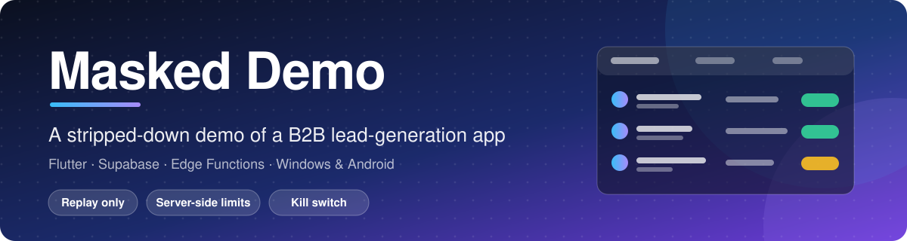
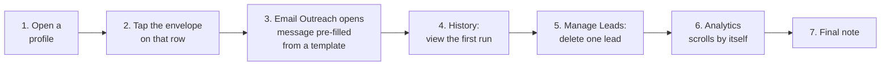
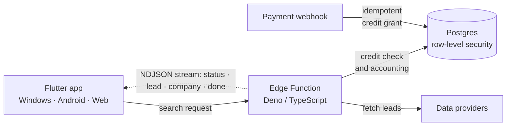
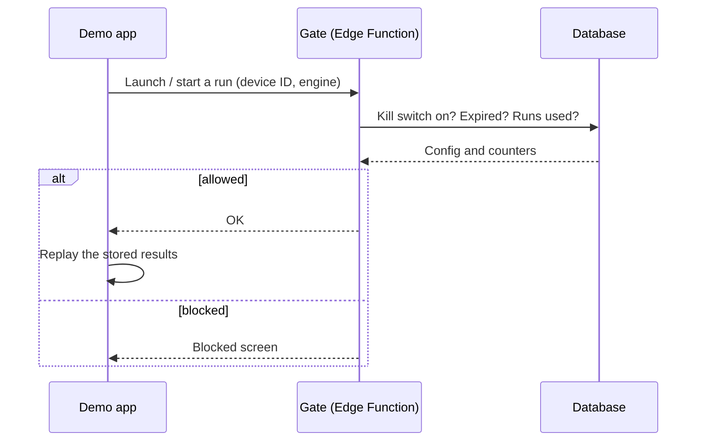

 

**[⬇️ Download the builds](../../releases)** &nbsp;·&nbsp; **[▶️ How to use it](#how-to-use)** &nbsp;·&nbsp; **[🔒 Why it is locked down](#locked-down)**

 

I built a B2B lead-generation app that finds people and companies from public sources and turns them into a clean, exportable list. **This repository is a stripped-down, locked-down demo of it**, submitted with my application for the **AI Automation, Systems & Software Builder** role. It contains **only the compiled builds** (see [Releases](../../releases)) and this page. The source code is not published.

> [!TIP]
> **Fastest way in:** download from [Releases](../../releases) → log in with `demo` / `demo` → pick a stored search → press **Search**. Two minutes to see the product, a few more for the guided tour.

| | |
|---|---|
| 🔑 **Login** | `demo` / `demo` |
| 🔁 **Runs** | 2 per engine, per device |
| 🌐 **Internet** | Required at every launch |
| ⏳ **Expires** | 28 January 2027 |

---

## ⬇️ Download

| Platform | File | Notes |
|---|---|---|
| 🪟 **Windows 10/11 (64-bit)** | `MaskedDemo-windows-x64.zip` | Unzip the **whole folder**, then run the `.exe` inside it. The exe does not work on its own. |
| 🤖 **Android** | `MaskedDemo-android.apk` | Allow "install from this source" when prompted. |

<b>Install help (SmartScreen, Play Protect, checksum)</b>

 

- **Windows SmartScreen:** the exe is unsigned, so Windows may say "Windows protected your PC". Click **More info → Run anyway**.
- **Android:** Play Protect may warn about an unknown app. Choose **Install anyway**.
- **Integrity check (PowerShell):** `Get-FileHash .\MaskedDemo-windows-x64.zip -Algorithm SHA256`, then compare with `SHA256SUMS.txt` in the release.

---

## ▶️ How to use it (about 5 minutes)

1. **Log in** with `demo` / `demo`.
2. A **guided walkthrough** starts. It runs on every login, and its last step is a short demo notice you must read.
3. Pick an engine: **LinkedIn**, **Facebook** or **Instagram**.
4. Choose a **stored search** from the dropdown. You cannot type your own query in the demo ([why](#locked-down)).
5. On LinkedIn you can switch between **Individuals** and **Companies**.
6. Press **Search**. Results stream into the table.
7. When the first run finishes, a **second guided tour** takes over:

You can **Skip** either tour at any time.

<!--
SCREENSHOTS (add when you have them, then remove the comment markers around this block):

  
  
   
  

-->

---

## 🧭 What the full app does

The full app, which is **not** what you are running here, has:

- 🖥️ A **Flutter / Dart** client for Windows, Android and web.
- 🗄️ A **Supabase** backend: Postgres with row-level security, Auth, and **Edge Functions (Deno / TypeScript)**.
- ⚡ A **streaming search engine**: the Edge Function streams results to the app as NDJSON events (`status`, `lead`, `company`, `done`), so leads appear live while a run is in progress. The Dart client and the function share one written contract and are changed together.
- 🔎 Client-side engines for general web search and for social platforms, with deduplication, confidence scoring and email checks.
- 💳 **Credit-based billing with server-side accounting** and an idempotent payment webhook, so a run can never spend more than the balance allows and a payment cannot be credited twice.
- 🧭 An in-app guided walkthrough and a layout tested across phone and desktop sizes.

---

## 🔒 Why it is locked down

This build is a **demo**, so much of the real app is deliberately removed or replaced. That is on purpose, not a bug.

| In the real app | In this demo | Why |
|---|---|---|
| Live searches against paid data sources | **Replays stored results** bundled with the app | Live runs cost real money per lead. A demo must not spend it. |
| Free-text job title, niche and location | **Dropdown of stored searches only** | Replayed data can only answer searches that were actually run. |
| Hundreds of leads per run | **Max 5 people per run**; LinkedIn companies capped at 2 companies × 2 people | Keeps the demo small. |
| Sign-up, accounts, saved data | **One hardcoded `demo` / `demo` login**; nothing is saved between sessions | No accounts or personal data to manage. |
| Billing, plans, payments | **Disabled**; shows a "stripped for the demo" message | Nothing to charge for. |
| Sending email through your own mailbox | **Disabled**. You can compose and see the template filled in, but nothing is sent | A demo must not email real people. |
| Capturing an email address from a profile | **Removed** | Same reason. |
| Advanced search options | **Disabled** | Same reason as the dropdown. |
| Facebook and Instagram needing a logged-in session | **Replay only**, no social login | Reviewers should never have to sign in to a personal account. |

### 🛡️ The access gate

The one part of the backend that is live in this build is a small **gate** I wrote so a demo can be handed out safely:

- **Server-side run limits.** A Supabase Edge Function (`demo-gate`) tracks **runs per engine per device**, so editing the app does not give you more runs.
- **Stable device ID.** It is derived from a stable machine identifier and hashed, so reinstalling does not reset the counter.
- **Remote kill switch and expiry date.** Either can disable every copy that is out in the wild.
- **No offline mode.** That is deliberate: if the app ran offline, the kill switch and counters could be bypassed by cutting the network.

> [!NOTE]
> **Honest limitation:** the device ID is supplied by the client, so a determined person could forge IDs. This is a speed bump against casual reuse, not hard security.

---

## 🧩 What this shows for the role

| The role asks for | Where it shows up here |
|---|---|
| Connect platforms with APIs and webhooks | A streaming Edge Function API, and a payment webhook that grants credits idempotently |
| Systems that are **reliable**, not just a demo that works | 700+ automated tests, clean static analysis, and every money or abuse rule enforced on the server |
| Turn an idea into something that works end to end | A full app: client, database, backend functions, billing, a guided tour and a locked-down release |
| Supabase and AI-assisted coding | Postgres with row-level security, Auth and Edge Functions, built with AI coding tools (Claude among them) plus my own engineering |

---

## 🗂️ About the data

> [!WARNING]
> The replayed results come from real searches I ran during development. They contain **real public profile details, not masked**, and **View profile** opens the person's real public page. They are here only so the demo looks like the real product. Please do not copy, scrape, store, contact or reuse any of it.

- Some results are not strictly in the searched country (for example a few US results can appear under "UK"). That is what the real runs returned, and I left the data as it was.
- If you find a profile you want removed, email me and I will take it out of the next build.

---

## 🛠️ How it was built

I built it myself, using AI coding tools throughout alongside my own experience and software engineering knowledge. It is not a one-prompt product. The habits behind it are the ones I would bring to the role:

- **Plan first, then change small.** One scoped change at a time, with the app-to-backend contract kept in step on both sides.
- **Check live state, not notes.** Before changing anything I check what is actually deployed.
- **Reliability over a pretty demo.** Static analysis is clean and there are **700+ automated tests**, including layout-overflow sweeps across screen sizes. Anything involving money or abuse is enforced on the server.
- **Keep a handover log** for every session, so work can be resumed and decisions are written down.

---

## ⚠️ Known limitations

- Windows and Android only. No web or iOS build here.
- Needs internet at every launch.
- Unsigned binaries trigger OS warnings (see install help above).
- After 2 runs per engine, or after the expiry date, the app shows a blocked screen.
- Not tested on a clean machine other than my own yet.

---

## ✉️ Contact

**Akpojero Efemena** · Nigeria (WAT) · [akpojeroe@gmail.com](mailto:akpojeroe@gmail.com)

Questions, bug reports and removal requests are welcome by email or in Issues.

 

Masked Demo is a restricted demonstration build, provided as is for evaluation only. It may not be redistributed or reverse engineered, and its data may not be reused. All rights reserved.

